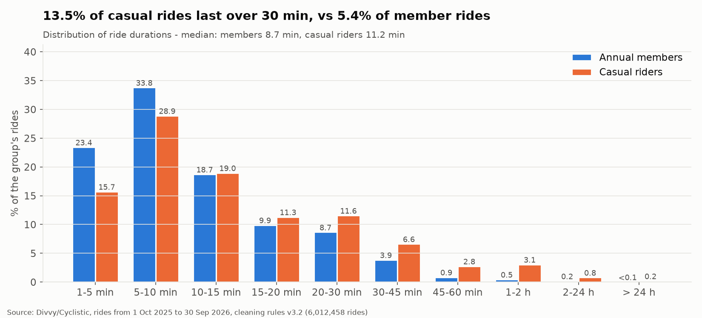
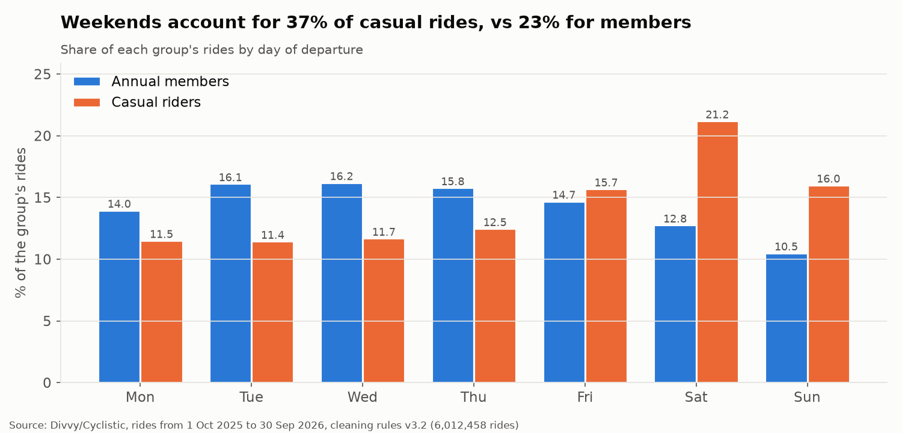
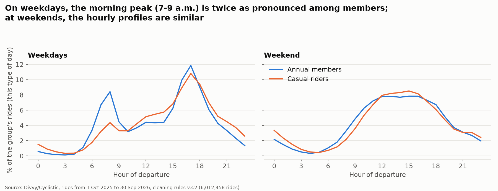
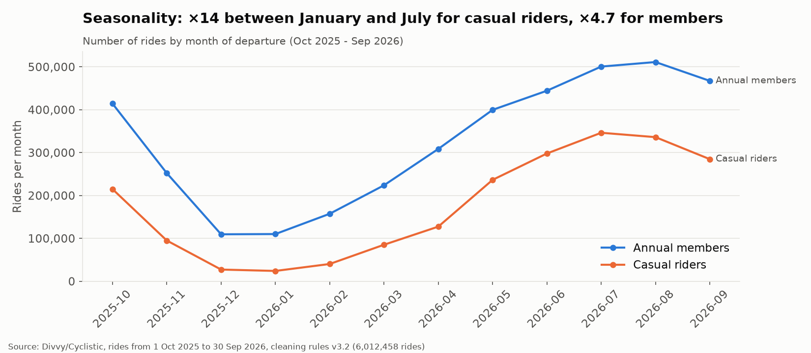
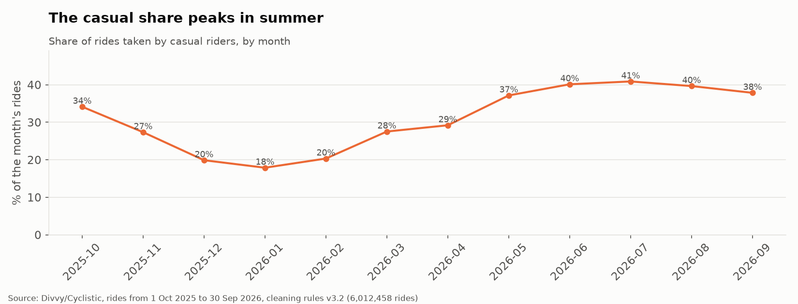
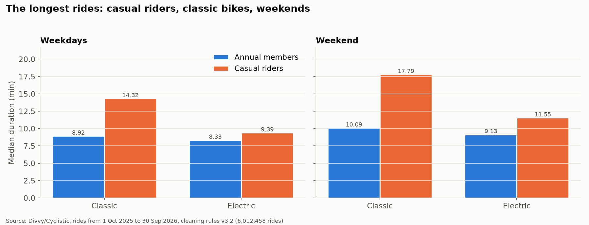
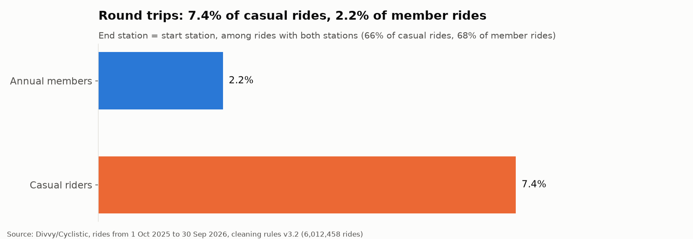

# Cyclistic Bike-Share: How Annual Members and Casual Riders Use Bikes Differently

**An end-to-end analysis of 6,012,458 Chicago bike-share rides (October 2025 – September 2026), using PostgreSQL, Python and LaTeX, to support a marketing strategy aimed at converting casual riders into annual members.**

The project follows the six phases of the Google Data Analytics process (Ask, Prepare, Process, Analyze, Share, Act). It combines:

- a fully traceable data-cleaning pipeline: the raw data are never modified, 72 quality checks are run, and sensitivity analyses test the cleaning choices;
- a comparative analysis of usage patterns;
- three testable business recommendations, each with an evaluation framework.

📄 **Full report:** [Cyclistic_Professional_Report.pdf](reports/Cyclistic_Professional_Report.pdf) (21 pages)

---

## Executive summary

Annual members take **64.8%** of the 6,012,458 analyzed rides. Their rides are short, regular and concentrated on weekdays, with commuting-style morning and evening peaks. Casual riders take longer rides (median **11.2 vs 8.7 minutes**), ride more at weekends (**37.2% vs 23.3%** of their rides), and are far more seasonal. Yet **23.1% of casual rides** (487,667 rides) start on weekdays during peak hours, which suggests that part of casual usage already resembles member usage. These differences hold in sensitivity analyses.

Three recommendations follow from these findings. They are **hypotheses to be tested** (A/B tests or test/control areas), not proven effects:

1. target casual riders whose usage looks utilitarian;
2. run a leisure-oriented spring–summer campaign;
3. personalize digital messages around ride duration and e-bike use.

## Business problem

Cyclistic is a fictional bike-share company in Chicago, based on the real Divvy system. According to the case study, it runs 5,824 bikes and 692 stations. Its finance analysts concluded that annual members are much more profitable than casual riders (single-ride and full-day pass users). The director of marketing, Lily Moreno, believes that future growth depends on converting casual riders into members.

## Research question

> **How do annual members and casual riders use Cyclistic bikes differently?**

This is the first of the three questions in the case study. The other two (why casual riders would buy a membership, and how digital media could influence them) need data that this data set does not contain: customer accounts, prices and survey responses.

## Project objectives

- Build a reproducible, auditable data pipeline from the 12 raw monthly files to analysis-ready data.
- Compare members and casual riders on volume, duration, day of week, season, hour of day, bike type and round trips.
- Turn the measured differences into marketing recommendations with explicit success metrics and an evaluation protocol.
- Clearly separate **measured facts**, **interpretations** and **hypotheses**.

## Dataset and provenance

| Item | Details |
|---|---|
| Source | [Divvy trip data](https://divvy-tripdata.s3.amazonaws.com/index.html), published by Chicago's bike-share system |
| License | [Divvy Data License Agreement](https://divvybikes.com/data-license-agreement): the data may be used in analyses and reports, but not redistributed as a stand-alone data set |
| Period | Rides **started** from 1 October 2025 to 30 September 2026 (12 monthly files) |
| Volume | 6,171,785 raw rows → 6,012,458 rides after cleaning |
| Unit | One row = one ride. There is **no rider identifier**, so results describe rides, not people |

The raw data are **not included** in this repository. [`data/README.md`](data/README.md) explains how to download them and where to place them.

## Tools and technologies

- **PostgreSQL 18:** raw storage, cleaning in a single transaction, quality checks, read-only aggregations.
- **Python 3:** orchestration, audits and charts.
  - Standard library: `hashlib`, `csv`, `subprocess`.
  - **pandas** and **Matplotlib**.
- **XeLaTeX:** the professional report, based on an adaptation of the Eisvogel template.
- **Synthetic test suite:** 35 tests on a disposable PostgreSQL instance.

## Analytical methodology

| Phase | Work performed |
|---|---|
| **Ask** | Business task, stakeholders, question 1; scope limited to rides |
| **Prepare** | Download of 12 files, SHA-256 checksums, consistency audit (columns, dates, identifiers, duplicates) |
| **Process** | Raw import (all columns as text, with provenance), cleaning plan v3.2 reviewed several times, cleaning in one transaction, 72 quality checks |
| **Analyze** | Read-only SQL aggregations, consistency checks on totals, sensitivity analyses |
| **Share** | 11 charts and a 21-page report; every number in the report text is checked automatically against the result tables |
| **Act** | Three recommendations with metrics, baselines and an evaluation protocol |

Methodology details: [`docs/methodology.md`](docs/methodology.md).

## Data preparation and quality assurance

| Step | Rows excluded | Rows remaining |
|---|---:|---:|
| Raw data (12 CSV files) | – | 6,171,785 |
| Duplicate `ride_id` (same rides in the April and May files) | 35 | 6,171,750 |
| Ride started outside the period | 71 | 6,171,679 |
| Negative duration (clock change) | 29 | 6,171,650 |
| Positive duration shorter than 60 seconds (all e-bikes) | 159,192 | **6,012,458** |

- **Raw data are never modified.** The exhaustive fingerprint of the raw table is identical before and after cleaning, and every excluded row has exactly one reason.
- **Kept, not removed:** rides without a station (20.0% without a start station, 20.8% without an end station), rides without end coordinates and rides longer than 24 hours. They are only left out of the analyses that need this information.
- **Daylight saving time:** raw timestamps are unchanged; a correction is stored separately for the 40 rides spanning the skipped hour of 8 March 2026.
- **72 quality checks:**
  - 62 passed;
  - 8 informational;
  - 1 known anomaly of the source (no March ride ends in April);
  - 1 explained failure. A reference value rounded to 93,597 s was compared with an actual maximum of 93,597.011 s. This is an error in the reference, not in the data.
- **Sensitivity analyses:**
  - adding back the rides shorter than 60 s leaves the member/casual gap unchanged in direction (median casual 646.2 vs 669.9 s; members 510.6 vs 521.4 s);
  - removing 31 March and 1 April 2026 changes the overall median from 567.4 to 568.0 s.

Results: [`results/quality/`](results/quality/).

## Key findings

All percentages are computed on each group's rides unless stated otherwise. Sources: [`results/analysis/`](results/analysis/).

| Indicator | Annual members | Casual riders |
|---|---:|---:|
| Rides | 3,897,958 (64.8%) | 2,114,500 (35.2%) |
| Median ride duration | 8.7 min | 11.2 min |
| Mean ride duration | 12.6 min | 21.1 min |
| Rides of at least 30 minutes | 5.4% | 13.5% |
| Rides taken at the weekend | 23.3% | 37.2% |
| Weekday departures 7–9 a.m. (% of weekday rides) | 15.1% | 7.6% |
| Rides on e-bikes | 68.3% | 74.1% |
| Round trips (among rides with both stations) | 2.2% | 7.4% |
| Rides taken from May to September | 59.6% | 71.0% |

**Observed facts:**

- **Duration.** Casual rides are longer across the whole distribution. The gap is largest for classic bikes at weekends (median 17.79 vs 10.09 min) and smallest for e-bikes on weekdays (9.39 vs 8.33 min).
- **Seasonality.** Monthly volume varies ×14.4 for casual riders (January to July) and ×4.7 for members (December to August). The casual share of all rides ranges from 17.9% in January to 40.9% in July.
- **Hours.** On weekdays, the morning peak is twice as pronounced among members; both groups peak at 5 p.m. At weekends, the hourly profiles are almost identical.
- **A bridge.** 62.8% of casual rides take place on weekdays, and 23.1% start on weekdays during peak hours (7–9 a.m. and 4–7 p.m.), compared with 35.3% for members.

**Interpretation.** The member pattern is consistent with commuting and utilitarian trips; the casual pattern with leisure. The data do not reveal *why* riders choose a pass over a membership, nor how many people take these rides.

## Visualizations

All charts are generated from the aggregated tables by [`scripts/figures_analyse.py`](scripts/figures_analyse.py). Blue = annual members, orange = casual riders.















Additional charts:

- [ride volume](visualizations/f1_ride_volume.png)
- [median duration by day](visualizations/f3b_median_duration_by_day.png)
- [bike type](visualizations/f6_bike_type.png)
- [daily series](visualizations/f9_daily_series.png)

## Business recommendations

Each recommendation starts from a measured finding. The proposed action is a **hypothesis** whose effect must be demonstrated by an experiment before any large-scale roll-out.

| # | Recommendation | Main finding | Evaluation |
|---|---|---|---|
| 1 | **Convert casual riders with utilitarian usage.** Messages after weekday peak-hour rides present the membership as the plan for everyday trips | 23.1% of casual rides start on weekdays at peak hours | A/B test, 60-day conversion |
| 2 | **Leisure-oriented spring–summer campaign** (April–June), on social media, in the app and at the busiest leisure stations | 71.0% of casual rides from May to September; 37.2% at weekends | Test vs control areas |
| 3 | **Digital communication on ride duration and e-bikes.** After a long ride, compare the cost of the pass used with the membership, using the real price list | 25.1% of casual rides last at least 20 min; 74.1% are on e-bikes | A/B test between message variants |

## Measurement and evaluation framework

The primary metrics (conversions) require Cyclistic's account and membership data, which are **not available** in this data set. Secondary metrics can be computed from rides and provide context only.

| Rec. | Metric | Current baseline |
|---|---|---|
| 1 | **Primary:** 60-day conversion, exposed vs control group | not available |
| 1 | Share of weekday peak-hour rides taken by members | 73.8% |
| 2 | **Primary:** new memberships, test vs control areas | not available |
| 2 | Casual share of rides in April / May / June | 29.2% / 37.2% / 40.1% |
| 3 | **Primary:** clicks and conversions by message variant | not available |
| 3 | Rides of at least 30 min, casual / members | 13.5% / 5.4% |

Evaluation protocol:

- a randomized control group, or comparable control areas using difference-in-differences;
- comparisons over the same period, because of strong seasonality;
- a success criterion and sample size fixed in advance;
- baselines recomputed with the same scripts and cleaning rules.

## Limitations

- **Rides, not people:** no customer count, no individual ride frequency, no demographics.
- **No prices, pass types or weather.** The recommendations' economics must be validated with the finance team.
- **A single year:** seasonality and the underlying trend cannot be separated.
- **Station coverage:** about 20% of rides have no start or end station, mostly e-bikes, so station-level analysis is deferred.
- **Provisional 60-second threshold** (tested by sensitivity analysis).
- **Source characteristics:**
  - a possible gap of about 28–102 rides at the March–April boundary (an estimate, not a measurement);
  - rides ending in October 2026 not yet published;
  - 474 rides overlapping the fall clock change, not corrected.
- **Language of the code:** code comments, console messages, SQL comments and CSV column names are in French. [`results/README.md`](results/README.md) translates the column names.

## Repository structure

```
Cyclistic/
├── README.md                  this file
├── LICENSE                    MIT (code)
├── LICENSE-content.md         license scope: code, content, third-party material
├── requirements.txt           Python dependencies
├── config/                    cleaning rules (v3.2) and expected reference values
├── data/README.md             data source, license and expected file layout (no data stored)
├── docs/
│   ├── methodology.md         cleaning rules, QA and sensitivity analyses (English)
│   └── plan_nettoyage_v3.2.md original cleaning specification (French, required by run_clean.py)
├── sql/                       import, cleaning, QA, sensitivity and analysis queries
├── scripts/                   pipeline, chart and report scripts
├── tests/                     synthetic tests of the cleaning pipeline
├── results/
│   ├── analysis/              12 aggregated CSV tables
│   └── quality/               QA results and sensitivity analyses
├── visualizations/            11 charts (PNG)
└── reports/
    ├── Cyclistic_Professional_Report.pdf
    └── latex/                 report sources (English) and Eisvogel template notice
```

## Reproducibility

### Rebuild the charts and the report (no database needed)

These steps use only the published aggregated tables.

```bash
pip install -r requirements.txt
python -I scripts/figures_analyse.py
python -I scripts/build_latex_report.py
```

The report build needs XeLaTeX and the fonts listed in [`reports/latex/README.md`](reports/latex/README.md).

### Rerun the full pipeline (requires the raw data and PostgreSQL)

Prerequisites:

- PostgreSQL 18 with `psql` on the `PATH`, or the `PSQL` environment variable pointing to it;
- a role allowed to create a database;
- the 12 Divvy files placed as described in [`data/README.md`](data/README.md).

The password is never stored. It is read from `PGPASSWORD` (session only), from a `pgpass` file, or from a masked prompt.

```bash
python -I scripts/audit_collecte.py data/raw data/extracted
python -I scripts/run_import.py
python -I scripts/run_clean.py
python -I scripts/run_clean.py --execute --confirm v3.2
python -I scripts/run_analyse.py
```

1. `audit_collecte.py`: consistency audit of the downloaded files (read-only).
2. `run_import.py`: creates the `cyclistic` database and imports the raw data, then runs the import checks.
3. `run_clean.py`: pre-checks only (read-only, the default).
4. `run_clean.py --execute --confirm v3.2`: runs the cleaning in one transaction, followed by the QA and sensitivity analyses.
5. `run_analyse.py`: read-only aggregations, written to `results/analysis/`.

`run_clean.py` refuses to run if the files, checksums or raw-table fingerprint differ from the audited reference values in [`config/attendus_v3.2.json`](config/attendus_v3.2.json). It also refuses a second execution.

### Tests

```bash
python -I tests/test_cleaning_synthetic.py
```

The test suite:

- creates a disposable PostgreSQL instance (`initdb`, port 55433, temporary folder, deleted afterwards);
- runs 35 checks on 20 synthetic rides: every cleaning rule, refusals, rollback, unchanged raw data and analysis extraction.

It needs the PostgreSQL server binaries; it currently calls `initdb.exe` and `pg_ctl.exe`, so it runs on **Windows**. It does not touch any existing database.

What was verified when this repository was prepared: the test suite (35/35 passed), the chart script and the report build (all 246 numbers quoted in the report text matched the result tables). The full pipeline was not rerun for this publication, because the published results come from the original audited run.

## Report

- 📄 [**Cyclistic_Professional_Report.pdf**](reports/Cyclistic_Professional_Report.pdf): 21 pages.
  - executive summary;
  - context, data and methodology;
  - cleaning and QA;
  - comparative analysis;
  - annotated charts;
  - recommendations, evaluation framework and limitations;
  - references and reproducibility appendix.
- LaTeX sources: [`reports/latex/`](reports/latex/).

## Licenses and attributions

- **Code:** [MIT](LICENSE).
- **Report, charts, aggregated tables and documentation:** [CC BY 4.0](https://creativecommons.org/licenses/by/4.0/).
- **Divvy trip data:** [Divvy Data License Agreement](https://divvybikes.com/data-license-agreement); not redistributed here.
- **Report layout:** adapted from the [Eisvogel](https://github.com/Wandmalfarbe/pandoc-latex-template) template (BSD 3-Clause, Pascal Wagler and John MacFarlane).
- **Case study:** *Case Study 1: How does a bike-share navigate speedy success?*, Google Data Analytics Professional Certificate. The brief is not distributed.

Full scope and third-party notices: [`LICENSE-content.md`](LICENSE-content.md). This is an independent educational project. It is not affiliated with or endorsed by Divvy, Lyft, the City of Chicago, Google or Coursera.

## Author

**LUMU BAMANA MANASSE**: analysis, data pipeline, report and documentation. Capstone project for the Google Data Analytics Professional Certificate (2026).
